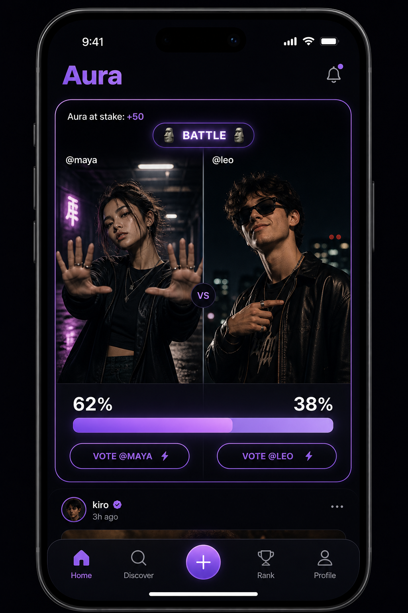
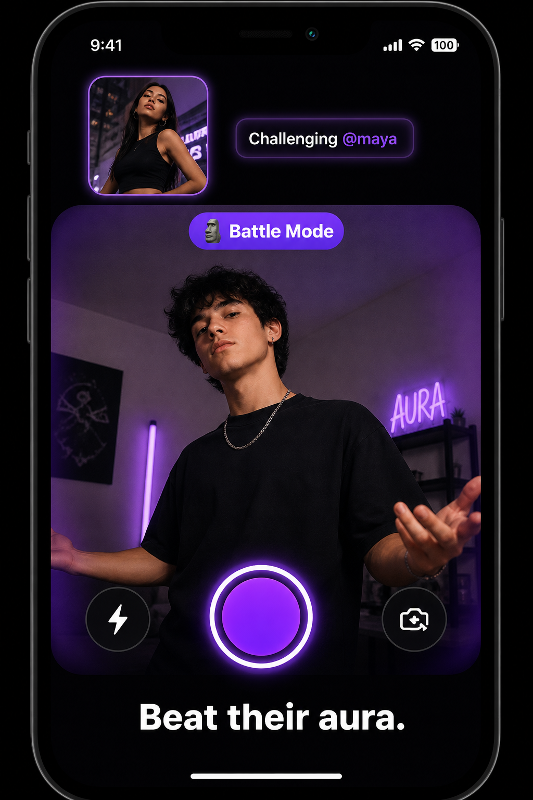
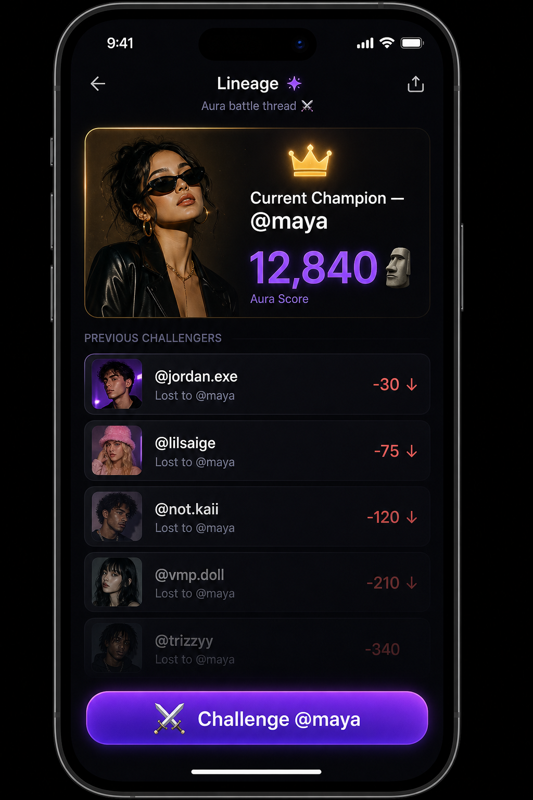
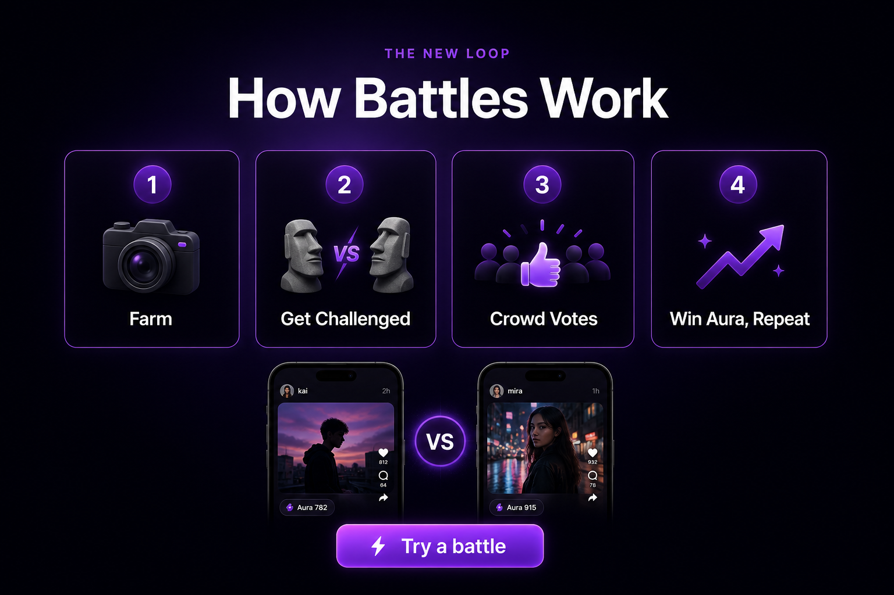

# Aura Battles — head-to-head challenges

Detailed design for the "V1 competition" line already flagged as **later** in
[early-beta-launch.md](./early-beta-launch.md) and stubbed as
undesigned in [roadmap.md](./roadmap.md) Milestone M2. This doc turns
"battles, challenges" from a placeholder into something buildable.

**This does not change what ships for early beta.** The current wave proves
`Discover → Like → Gain Aura → Climb → Post` with 20-50 testers. Battles are
the next loop, sequenced after that, not instead of it. Read this as the plan
for when "later" arrives — with one fast-follow option flagged in §10 if we
want a thin slice sooner.

Companion: [roadmap.md](./roadmap.md) · [product-spec.md](./product-spec.md) ·
[backend-architecture.md](./backend-architecture.md) · [brand.md](./brand.md)

---

## 1. Why this, not just more of the like button

**The trend we're actually looking at is not "post and get likes."** It's
head-to-head. As of August 2026, "aura battles" jumped from TikTok/Instagram
into real life across Mexico, Argentina, Brazil, Bolivia, Peru, Ecuador,
Venezuela, and now Spain: two people stand in a circle, take turns posing
(mewing, the 6-7 gesture, the Siuuu jump, sigma stares), a crowd films it,
the crowd decides who won. A São Paulo organizer ("Uvitinho") ran a
"Campeonato de Farmar Aura" that drew 200+ people. An Argentine teenager won
3,000 pesos in a bracket. Boca Juniors' players are posting aura-battle
memes. There is no fixed scoring rubric anywhere in the real trend — that
looseness is part of the joke.

**Our current loop is structurally the wrong shape for that.** `auraForLike()`
is flat, one-directional, and always positive — every like is +10 to
someone, in isolation, forever. The meme is relational: aura is won or lost
*against someone*, in public, and "negative aura" is a completely normal
thing to say. A feed of isolated posts with a nicer name for "like" is
Instagram with a reskinned button, not aura farming.

**We are not starting from zero on this.** The ledger was already built to
take it:

- `docs/backend-architecture.md` §2 point 7: *"Vote Power, Aura Sense,
  **battles**, and seasons should plug into the ledger and event bus later —
  not into random `UPDATE users SET aura = aura + 1` calls."*
- `docs/product-spec.md` already lists `Battle win → celebratory state` and
  `Challenge win → reward animation` as required feedback states.
- The ledger already has typed events (`LIKE`, `BONUS`, `REVERSAL`) applied
  through one `AuraLedgerService.apply()` call site. Adding `BATTLE_WIN` /
  `BATTLE_LOSS` is a new event type through the same door, not a rewrite.
- We already ship `pt-br` and `es` ([#76](https://github.com/pedrommarquesm/aura/pull/76)),
  which happens to be exactly the language footprint of where this trend
  actually lives right now.

**And the brand name got funnier by accident.** `auraclimb.com` was picked
in [#74](https://github.com/pedrommarquesm/aura/pull/74) for domain
availability, before this plan existed — "climb" as in the leaderboard.
"Climb" also just describes what a battle win does to your rank. Nobody
planned that; it still works.

None of this makes the bet safe. Two real risks, stated plainly, with how
this plan answers them:

| Risk | Answer |
|---|---|
| Slang-driven trends (mewing, 6-7, looksmaxxing, rizz) usually have a few-month half-life. Building something that only works while "aura" is the hot word is racing a clock. | Ship the mechanic (head-to-head comparison, crowd judging) as something durable on its own, not as a costume on top of the current slang. If the word changes, the loop still works. |
| The real trend right now is concentrated in Latin America, ages ~14-20. That is a specific audience and go-to-market, not "everyone." | We already have `pt-br` / `es` shipped. Decide on purpose (§11) whether to lean into that or treat it as one market among several — don't drift into it by accident. |

---

## 2. The new loop

Old: `Discover → Like → Gain Aura → Climb → Post → Repeat`

New, as two loops that share one Aura economy:

```text
FARM           Post a solo photo/video. Works exactly like today — likes
               still give +10 Aura. This never goes away; not every post
               needs a fight.

  ↓ (someone challenges it — opt-in, never forced)

CHALLENGE      A challenger posts their own attempt to beat it. That
               pairing is a Battle: two clips, one vote.

  ↓

BATTLE         The crowd votes. Winner gains Aura. Loser does not lose
               lifetime Aura (see §5) but loses that battle, publicly,
               on the record.

  ↓

REIGN          Whoever is currently unbeaten on that thread is the
               "champion" people line up to dethrone. The next
               challenger fights the champion, not the original poster
               — a lineage forms, not a flat pile of 1-offs.

  ↓ (repeat, or answer back — a rebuttal opens Round 2 of the same feud)
```

Alongside the organic loop, **Aura Cup** is the app-run version: scheduled
prompts, brackets, timed voting rounds, a real end and a real champion
(§8). It exists mainly to solve cold start — day one, there's nobody to
challenge, so official brackets guarantee something to vote on while the
peer-to-peer loop builds density.

---

## 3. Vocabulary (lock this before writing UI copy)

Same rule as [i18n.md](./i18n.md): the words below never get translated —
they're product words, not descriptions, exactly like **Aura** already is.

| Term | Meaning |
|---|---|
| **Farm** | Post a solo photo/video meant to earn Aura. Already the verb we use. |
| **Challenge** | The act of responding to a Farm with your own attempt to beat it. |
| **Battle** | The paired object — original clip vs challenger clip — that the crowd votes on. |
| **Champion** / **Reign** | Whoever is currently unbeaten on a given battle thread. |
| **Lineage** | The history of challengers a champion has beaten, shown as a chain. |
| **Aura Cup** | An app-run, scheduled bracket tournament, distinct from organic challenges. |

`docs/i18n.md` §"What is never translated" gets a new row for **Challenge**,
**Battle**, and **Aura Cup** when this ships — noted here, not done in this
doc, since it touches four message catalogs.

---

## 4. What it looks like

Four concept screens, on-brand (existing dark theme, `--color-aura` violet
family, moai as the score glyph). These are directional, not final visual
design — enough to argue about shape and hierarchy before anyone touches
Figma.

### Feed: the VS card

A battle renders as its own card type in the normal feed — not a separate
tab — because the novelty of a split-screen vote card is exactly what should
stop a thumb mid-scroll.



### Challenging someone: the camera screen

Tapping **Challenge** on any eligible post opens the existing camera/upload
flow, just anchored to a target post. No new capture pipeline — same
shrink-before-upload path client media already uses.



### Post detail: the Lineage view

The "king of the hill" structure made visible: the current champion up top,
a fading trail of everyone they've beaten below, one clear CTA.



### Landing page: explaining the mechanic

A new section, same structural pattern as the existing "How you farm it"
four-step section, but for the new loop (§9 has the full copy plan).



---

## 5. The one decision everything else depends on

**Does losing a battle move `users.aura`, the number that drives your
lifetime rank and title?**

Two options:

1. **Lifetime Aura only goes up.** A battle loss costs you that specific
   matchup — it's recorded, shown, comedic ("lost to @maya, -30") — but your
   public lifetime total and title never regress. Battle record is a
   separate stat.
2. **Lifetime Aura can go negative.** Fully matches how people actually talk
   about the meme ("negative aura", "-9000 aura"), but a real user's public
   number and level title can now fall, which nobody has designed for
   (titles currently only go up: NPC → Aura Enjoyer → ... → Aura God).

**Recommendation: option 1.** Keep the meme's negative-number humor scoped to
the battle result, not the profile. This protects the leaderboard and title
progression from a mechanic that was designed to be a joke, not a punishment,
and avoids a genuinely new and harder problem (demotions, title loss copy,
"you got worse" as a push notification) that the real-world trend doesn't
actually require — the joke lands the same either way, "you lost this battle
by -9000" reads exactly as funny as "-9000 aura" flat.

This is called out explicitly because it is the thing most likely to get
silently decided wrong by whoever writes the first migration. Confirm it
before `AuraEvent` types are added.

---

## 6. Data model

Extends the existing ledger, does not replace it.

**New tables** (Drizzle, same conventions as `apps/api/src/db/schema/`):

```text
battles
  id, original_post_id, challenger_post_id,
  parent_battle_id      -- nullable; set for a rebuttal round (Round 2+)
  status                -- voting | decided
  aura_stake            -- integer, decided at creation (flat to start)
  winner_post_id        -- nullable until decided
  votes_close_at
  created_at, decided_at

battle_votes
  id, battle_id, voter_user_id, voted_for_post_id, created_at
  unique(battle_id, voter_user_id)   -- one vote per person per battle

aura_cups
  id, title, prompt_copy, bracket_size,
  submissions_open_at, submissions_close_at, status

aura_cup_entries
  id, cup_id, post_id, seed

aura_cup_matches
  id, cup_id, round, match_index,
  entry_a_id, entry_b_id, winner_entry_id,
  votes_open_at, votes_close_at
```

**Posts** gain one field: `challengeable: boolean`. Default is the open
decision in §11. A post created as someone's response to a challenge also
carries `battleId` so the client can render it as a challenger card instead
of a normal post.

**Ledger**: two new `AuraEvent` types through the existing
`AuraLedgerService.apply()` call site — no new write path.

```ts
// apps/api/src/aura/aura-ledger.service.ts — same shape as existing types
type: 'BATTLE_WIN'    // winner, +auraStake, metadata: { battleId, opponentPostId }
type: 'BATTLE_LOSS'   // loser, per §5: recorded on battle record, not users.aura
```

`REVERSAL` already exists for moderation takedowns — a removed battle entry
reverses the same way a removed post already does.

---

## 7. API surface

New modules, same shape as `waitlist`, `likes`, `moderation` today.

**`BattlesModule`**

| Method | Route | What it does |
|---|---|---|
| POST | `/v1/posts/:id/challenge` | Attach a new post as a challenger against `:id`. Creates the `battles` row, notifies the original poster. |
| GET | `/v1/battles/:id` | Battle detail: both clips, live vote split, time left. |
| POST | `/v1/battles/:id/vote` | Cast one vote. Idempotent per `(battleId, voterUserId)`, same pattern as `likes.service.ts`. |
| POST | `/v1/battles/:id/decline` | Original poster hides an unwanted challenge. No Aura effect either way — this is the anti-harassment valve, see §10. |
| POST | `/v1/battles/:id/rebuttal` | Post Round 2 against the same opponent; creates a child battle via `parent_battle_id`. |
| GET | `/v1/posts/:id/lineage` | Champion history for a thread — powers the Lineage screen. |

**`AuraCupModule`**

| Method | Route | What it does |
|---|---|---|
| POST | `/v1/cups/:id/submit` | Enter a post into an open cup's submission window. |
| GET | `/v1/cups/:id/bracket` | Current bracket state. |
| POST | `/v1/cups/matches/:id/vote` | Vote on one bracket match. |
| worker job | `advanceCupRound` | On `votes_close_at`, tally, set `winner_entry_id`, seed the next round. Same BullMQ pattern as trending recompute. |

Cups are staff-created to start (reuses the existing staff auth/audience
pattern) — nobody needs a public "create a tournament" flow yet.

---

## 8. Aura Cup, practically

This is the part with an actual real-world unmet need behind it: the São
Paulo organizer running a 200-person bracket almost certainly had a phone, a
speaker, and no tooling. The practical build is boring on purpose — it's
mostly borrowed from sports-bracket UX everyone already understands:

1. **Prompt.** Staff opens a cup with a title and a one-line prompt ("Best
   sigma stare", "Aura Cup: Round of 64"). Photos work for a daily cadence;
   video for a weekly, higher-effort one.
2. **Submissions.** Open window, first-N or top-N-by-early-reaction seeding —
   doesn't need to be clever at this size.
3. **Bracket.** Standard single elimination. 24h voting rounds: long enough
   to gather votes, short enough to keep momentum. Winner auto-advances,
   next round opens on its own.
4. **Recap.** A shareable bracket-result card at the end — the same object
   people already screenshot for March Madness or fantasy brackets. This is
   close to free distribution back onto TikTok/Instagram, which is where the
   actual audience already is.
5. **Optional real-world tie-in.** A cup can be scoped to a city and run
   during an actual park meetup — the app becomes the official bracket/vote
   tool for something already happening, rather than trying to invent a new
   reason for people to gather. This is also the natural home for a
   sponsored prize pool later (already happening informally — a football
   club riffing on this, a 3,000-peso prize in Argentina); not needed for a
   first version.

---

## 9. Landing page plan

Current sections (`apps/web/app/[locale]/page.tsx`): `Hero → Waitlist → Play
→ WhatIsAura → HowItWorks`. Proposed changes, same components/voice, nothing
torn out:

- **Hero.** Copy stays — "Your vibe, ranked" is still true. Add a small
  secondary link under the CTAs: *"See a battle ↓"*, anchor-scrolling to the
  new section. Don't touch the primary waitlist conversion path to sell a
  feature that isn't live yet.
- **New section: "How Battles Work."** Same four-step card pattern as the
  existing "How you farm it" section, new copy: **Farm → Get Challenged →
  Crowd Votes → Win Aura, Repeat.** Mockup above (§4) shows the shape.
- **New interactive demo, next to the existing "Try it" double-tap demo.**
  The existing `Play` section already lets a visitor double-tap a demo post
  with nothing leaving the page. Add a second demo state: two demo clips
  side by side, tap to vote, watch the aura split move live. Same "nothing
  leaves this page, sign in only to act for real" pattern already used for
  likes.
- **WhatIsAura copy nudge.** Current line: *"You don't need a following to
  be seen. You don't buy Aura. You farm it."* Add the comparison angle once
  battles exist: *"Aura isn't just earned. It's won."* — small edit, not a
  rewrite.
- **Meta/OG/keywords.** Add "aura battles" / "aura challenge" once the
  feature is real; premature otherwise (don't advertise a mechanic that
  doesn't exist yet — this is exactly the mistake `marketing-launch-plan.md`
  already warns against for the store launch).
- **New public page:** `/a/:username/battle/:battleId`, mirroring the
  existing post permalink pattern (`/a/:username/post/:postId`) — viewable
  signed out, vote requires sign-in, same as likes today.

None of this ships before the mechanic itself works end-to-end in the app —
the landing page explains a real feature, it doesn't announce a roadmap
item.

---

## 10. Anti-abuse, up front, not as a fast-follow

"Anyone can enter the loop" is the fun part and also the part that will
produce a harassment vector if it's not designed in from day one:

- **`challengeable` is a real toggle, not cosmetic.** The default (§11) needs
  a real answer, but either way the original poster can always decline a
  specific challenge with no Aura penalty for either side — the equivalent
  of a crowd booing a battle that turned mean, made explicit in software.
- **Rate limits, same shape as existing `LIKE_RATE_LIMIT_*` /
  `WAITLIST_RATE_LIMIT_*`:** cap challenges sent per user per day, and cap
  how many *simultaneous open challenges* a single post can accumulate, so
  one popular post can't be dogpiled by fifty mocking responses at once.
- **Tone is a design constraint, not just copy.** Losing has to read as
  funny, not as a real status hit — this is why §5 keeps lifetime Aura
  protected, and it should extend to microcopy, animation, and sound design
  on the loss state. If a real user feels genuinely humiliated by the
  product working as designed, the mechanic has failed regardless of
  engagement numbers.

---

## 11. Open decisions (answer these before writing migrations)

| # | Question | Recommendation | Why it's not a slam dunk either way |
|---|---|---|---|
| 1 | Does a battle loss ever touch `users.aura` (lifetime)? | No — battle record only (§5). | The literal meme says negative lifetime aura; we're trading meme-accuracy for leaderboard/title integrity on purpose. |
| 2 | Is `challengeable` opt-in or opt-out by default? | Opt-in at first (safer, slower growth of the loop). | Opt-out gets the loop dense faster, which matters for a feature that needs critical mass to feel alive, but raises the harassment surface on day one when moderation tooling is thinnest. |
| 3 | Photos, video, or both at launch? | Photos first. | Photos match the lowest-friction real-world version ("best sigma pose") and reuse the existing avatar-crop-style capture flow; video battles need the heavier create pipeline (shrink, Mux) for both sides of every matchup. |
| 4 | Lean into the LatAm/`pt-br`+`es` audience on purpose, or stay audience-agnostic? | Worth deciding explicitly, not drifting. | We already ship the right locales, which is a real advantage; but "build for where the meme currently is" and "build for wherever Aura's actual users are" may not be the same answer once we look at real waitlist geography. |

---

## 12. Phasing

Sequenced after the current early-beta plan, not competing with it for the
same engineering time.

1. **Design lock.** Answer §11. Add `Challenge` / `Battle` / `Aura Cup` to
   `docs/i18n.md`'s never-translated list.
2. **MVP organic loop, mobile only.** `challengeable` field, `POST
   /challenge`, `POST /vote`, VS card in the feed, ledger `BATTLE_WIN` /
   `BATTLE_LOSS`, Lineage view (win/loss count is enough — the full visual
   chain can wait). Web stays view-only.
3. **Feuds and polish.** Rebuttal rounds (`parent_battle_id`), challenge
   notifications, web voting (not just viewing), public battle permalinks,
   the landing page section from §9.
4. **Aura Cup.** Bracket engine, the `advanceCupRound` worker job, staff
   tooling to open a cup, shareable recap card.
5. **Real-world tie-in.** City-scoped cups, optional sponsor prize field,
   basic virality tracking on battle shares.

**If there's appetite to move faster than "after early beta":** the smallest
honest slice is step 2 with `challengeable` opt-in and a hard cap on
simultaneous challenges per post (§10), tested inside the current private
tester wave rather than waiting for a public launch. That derisks the
mechanic itself before committing to Aura Cup infrastructure, without
touching the current beta's core loop.
