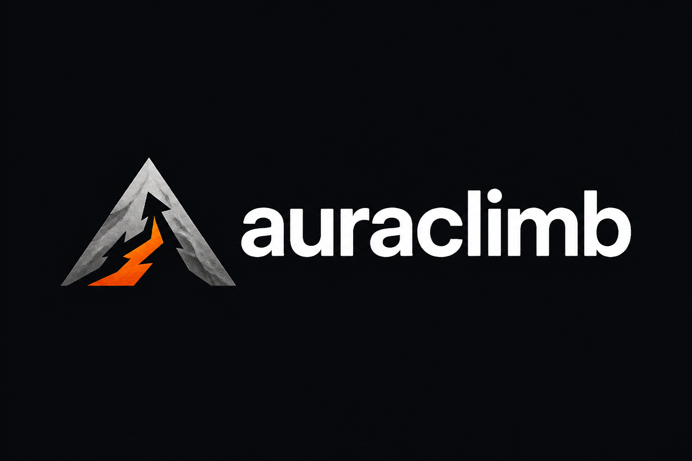

# Auraclimb Logo Guide

Brand identity and logo usage guidelines.

---

## Logo Versions Overview

We have 8 logo variations designed for different use cases. Each maintains the competitive, bold vibe of the brand while serving specific purposes.

---

## Version 1: Moai Icon + Arrow

**File:** `auraclimb-logo-moai-arrow.png`

**Description:**
Stylized moai stone head (🗿) with upward arrow. Direct reference to aura meme culture.

**Dimensions:** 1:1 square

**Colors:**
- Background: Deep black/charcoal
- Moai: Stone gray
- Arrow: Fire red/orange accent

**Best Used For:**
- Social media profile picture (TikTok, Instagram, Twitter)
- Favicon
- Discord server icon
- Telegram channel icon
- App icon (alternative to podium)

**Why It Works:**
- Instantly recognizable to Gen Z
- Ties directly to aura meme culture (🗿)
- Meme-friendly
- Cultural relevance

**When to Use:**
When you want to emphasize the cultural connection and meme origins. Best for social contexts where the audience already knows aura culture.

---

## Version 2: Wordmark Horizontal

**File:** `auraclimb-logo-wordmark-horizontal.png`

**Description:**
Icon (stylized 'A' as mountain/stairs) + 'AURACLIMB' wordmark. Full horizontal lockup.

**Dimensions:** 16:9 landscape

**Colors:**
- Background: Dark charcoal/black
- Icon: Stone gray with fire orange peak
- Text: White, all caps, bold sans-serif

**Best Used For:**
- Website header/navigation
- Email signatures
- Presentation slides
- Partner materials
- Press kit
- Letterhead

**Why It Works:**
- Professional but not corporate
- Clear brand name
- Icon can be separated and used alone
- Sports brand aesthetic

**When to Use:**
When you need the full brand name visible. Professional contexts, partnerships, formal communications.

**Minimum Size:** 200px wide (maintain legibility)

---

## Version 3: Graph/Mountain Peak

**File:** `auraclimb-logo-graph-climb.png`

**Description:**
Abstract upward-trending graph/mountain peaks. Represents climbing and progress.

**Dimensions:** 1:1 square

**Colors:**
- Background: Black
- Graph: Stone gray transitioning to fire red/orange at peak

**Best Used For:**
- App icon
- Loading screens
- Achievement badges in-app
- Progress indicators
- Email/notification graphics
- Chart/data visualizations

**Why It Works:**
- Abstract but clear meaning (upward movement)
- Scales beautifully
- Not overly literal
- Represents data/competition

**When to Use:**
When you want a clean, abstract representation. Good for contexts where you're showing progress, rankings, or data.

**Scales Well:** Yes, works from 16px to large format

---

## Version 4: Stacked Wordmark

**File:** `auraclimb-logo-wordmark-stacked.png`

**Description:**
'AURA' over 'CLIMB' with integrated upward arrow. Bold typography-focused design.

**Dimensions:** 1:1 square

**Colors:**
- Background: Black
- Text: White, extra bold sans-serif
- Arrow: Fire red/orange (integrated into text)

**Best Used For:**
- App splash screen
- Instagram square posts
- Merchandise (t-shirts, stickers)
- Square social media posts
- Print materials

**Why It Works:**
- High impact typography
- Very readable
- Arrow naturally integrated
- Works at any size
- Bold, direct

**When to Use:**
When typography needs to be the hero. Perfect for merchandise, posters, square social posts.

**Minimum Size:** 150px × 150px

---

## Version 5: Badge/Emblem

**File:** `auraclimb-logo-badge.png`

**Description:**
Circular badge with mountain peaks inside. Gaming/esports aesthetic.

**Dimensions:** 1:1 square

**Colors:**
- Background: Black
- Outer ring: Stone gray
- Inner design: Mountain peaks
- Accent: Fire orange at peak

**Best Used For:**
- In-app achievement badges
- Profile badges/titles
- Tournament/competition graphics
- Premium features branding
- Winner announcements
- Level/rank badges

**Why It Works:**
- Premium, official feel
- Gaming/esports vibe
- Circular format works for badges
- Emblem = authority/achievement

**When to Use:**
For rewards, achievements, special status indicators. When you want to convey premium/exclusive.

**Use Cases:**
- "Verified" badges
- Rank badges (Aura Lord, Aura God)
- Tournament winner badges
- Season champion badges

---

## Version 6: AC Lettermark

**File:** `auraclimb-logo-lettermark-ac.png`

**Description:**
Minimalist 'AC' monogram with small upward arrow. Ultra clean.

**Dimensions:** 1:1 square

**Colors:**
- Background: Black
- Letters: Stone gray, bold geometric
- Arrow: Fire red/orange (small, integrated)

**Best Used For:**
- App icon (PRIMARY RECOMMENDATION)
- Favicon
- Small space applications
- Watermarks
- Social media profile pics (alternative)

**Why It Works:**
- Scales perfectly to tiny sizes
- Instantly recognizable silhouette
- Ultra minimal = modern
- Strong at 16px and 1024px
- Clean, confident

**When to Use:**
When space is limited or you need maximum clarity at small sizes. This is the most scalable logo.

**App Icon Recommendation:**
This is our #1 pick for iOS/Android app icon due to:
- Perfect scaling
- Clear at all sizes
- Unique silhouette
- Not trying to do too much

**Minimum Size:** 16px × 16px (still recognizable)

---

## Version 7: Podium/Stairs

**File:** `auraclimb-logo-podium.png`

**Description:**
Geometric winner's podium (3 steps ascending). Represents ranking system.

**Dimensions:** 1:1 square

**Colors:**
- Background: Black
- Steps: Stone gray gradient to fire orange (highest step)

**Best Used For:**
- App icon (PRIMARY RECOMMENDATION)
- Leaderboard graphics
- Competition/tournament branding
- Ranking system visuals
- Winner announcement graphics

**Why It Works:**
- Instantly communicates ranking/competition
- Super clean geometry
- Universal symbol (podium = winning)
- Scales beautifully
- Clear at tiny sizes

**When to Use:**
When you want to emphasize the competitive/ranking aspect. Perfect for leaderboard contexts.

**App Icon Recommendation:**
This is our #1 pick for app icon (tied with Version 6) because:
- Clearest meaning at small size
- Directly represents core app function (climbing ranks)
- Unique among social apps
- Memorable shape

**Minimum Size:** 16px × 16px (still readable)

---

## Version 8: Lowercase Lockup

**File:** `auraclimb-logo-lockup-lowercase.png`

**Description:**
Icon + 'auraclimb' in lowercase. Modern, approachable lockup.

**Dimensions:** 4:3 landscape

**Colors:**
- Background: Dark charcoal/black
- Icon: Upward arrow/mountain, stone gray with orange accent
- Text: White, lowercase, bold sans-serif

**Best Used For:**
- Website landing page
- Marketing materials
- Social media covers
- Advertising
- Startup/tech contexts

**Why It Works:**
- Lowercase = modern, startup vibe
- Still bold and confident
- Professional but not stuffy
- Clean spacing
- Contemporary feel

**When to Use:**
Primary logo for web presence and marketing. Use when you want to feel modern and approachable while staying competitive.

**Recommended For:**
- Website header
- Landing page hero
- App store screenshots
- Marketing one-pagers

**Minimum Size:** 180px wide

---

## Usage Recommendations by Context

### Mobile App Icon (iOS & Android)

**Primary Recommendation:**

**Option A: Version 7 (Podium)** - 60% vote
- Clearest meaning (ranking/climbing)
- Scales perfectly
- Unique silhouette
- Instantly communicates app purpose

**Option B: Version 6 (AC Lettermark)** - 40% vote
- Ultra minimal
- Strong silhouette
- Modern
- Very scalable

**Don't Use:** Version 1 (Moai) - too meme-specific for app icon, better for social

**Export Specs:**
- 1024×1024px (App Store requirement)
- PNG with transparency
- No text smaller than 44px at 1024px size
- Test at 16px, 32px, 64px, 180px, 1024px

---

### Website Header

**Primary:** Version 8 (Lowercase Lockup)
**Alternative:** Version 2 (Wordmark Horizontal)

**Why:**
- Full brand name visible
- Horizontal format fits headers
- Professional
- Clear at standard header sizes (40-60px height)

**Implementation:**
```html

```

---

### Social Media

**Profile Pictures:**
- Instagram: Version 7 (Podium) or Version 1 (Moai)
- TikTok: Version 1 (Moai) - culturally relevant
- Twitter: Version 6 (AC Lettermark) or Version 7 (Podium)
- Discord: Version 1 (Moai) - meme-friendly
- Telegram: Version 7 (Podium) - official feel

**Cover Photos/Banners:**
- Use Version 2 or Version 8 (horizontal layouts)
- Add tagline: "Where your aura matters"

**Posts:**
- Square posts: Version 4 (Stacked Wordmark)
- Story formats: Version 7 or Version 6 with text overlay

---

### Marketing Materials

**Digital Ads:**
- Use Version 8 (Lowercase Lockup) or Version 2 (Wordmark)
- Ensure logo is at least 15% of ad space

**Print:**
- Merchandise: Version 4 (Stacked Wordmark)
- Business cards: Version 6 (AC) or Version 7 (Podium)
- Posters: Version 4 or Version 8

**Email:**
- Header: Version 8 or Version 2
- Footer: Version 6 (small) + text

---

### In-App Usage

**Splash Screen:**
- Version 4 (Stacked Wordmark) or Version 8 (Lockup)
- Animated: Logo fades in or builds up

**Loading States:**
- Version 6 (AC) or Version 7 (Podium) with spinner

**Badges/Achievements:**
- Version 5 (Badge) - perfect for this
- Customize colors for different achievement levels

**Watermarks:**
- Version 6 (AC) at 20% opacity

---

## Logo Don'ts

### Never:

❌ **Stretch or distort** the logo
- Always maintain aspect ratio

❌ **Change colors** outside brand palette
- Stick to black, white, stone gray, fire orange

❌ **Add effects** (drop shadows, glows, bevels)
- Keep it clean and flat

❌ **Place on busy backgrounds**
- Use solid colors or subtle gradients only

❌ **Use text logos smaller than minimum size**
- 150px minimum for wordmarks

❌ **Rotate the logo**
- Always keep upright and horizontal

❌ **Outline the logo**
- Let it breathe, no borders unless necessary

❌ **Use low-resolution versions**
- Always use source files, export at correct size

---

## Color Variations

### Primary (Default):
- Dark background
- White/stone gray elements
- Fire orange accents

### Alternative Light Version:
If you need a light background:
- White background
- Black text/elements
- Fire orange accents stay same

**When to use light version:**
- Print on white paper
- Light-themed interfaces (if app has light mode)
- Partner materials with light backgrounds

**Export both versions:**
- `logo-dark.png` (for dark backgrounds)
- `logo-light.png` (for light backgrounds)

---

## File Organization

```
marketing-assets/logos/
├── auraclimb-logo-moai-arrow.png          (Version 1)
├── auraclimb-logo-wordmark-horizontal.png (Version 2)
├── auraclimb-logo-graph-climb.png         (Version 3)
├── auraclimb-logo-wordmark-stacked.png    (Version 4)
├── auraclimb-logo-badge.png               (Version 5)
├── auraclimb-logo-lettermark-ac.png       (Version 6)
├── auraclimb-logo-podium.png              (Version 7)
└── auraclimb-logo-lockup-lowercase.png    (Version 8)
```

**Next Steps:**
1. Choose primary app icon (Version 6 or 7)
2. Export at required sizes
3. Create light versions if needed
4. Add to app and website
5. Update all social media profiles

---

## Export Sizes Needed

### App Icon
- 1024×1024px (App Store/Play Store)
- 512×512px (Play Store)
- 180×180px (iOS @3x)
- 120×120px (iOS @2x)
- 60×60px (iOS @1x)

### Favicon
- 32×32px
- 16×16px
- ico format (multi-size)

### Social Media
- 400×400px (Instagram, Twitter, Discord)
- 512×512px (Telegram)
- 1500×500px (Twitter banner)
- 1920×1080px (LinkedIn banner)

### Web
- 200px, 400px, 600px widths (responsive)
- SVG format (if possible, for infinite scaling)

---

## Final Recommendations

### Must Have:

1. **App Icon:** Version 7 (Podium)
   - Clearest at small sizes
   - Directly communicates ranking

2. **Website:** Version 8 (Lowercase Lockup)
   - Modern, professional
   - Perfect for landing page

3. **Social Profiles:** Version 1 (Moai) for TikTok, Version 7 (Podium) for others
   - Moai for cultural relevance on TikTok
   - Podium for official brand presence

4. **Marketing:** Version 4 (Stacked Wordmark)
   - Bold, high impact
   - Works on merchandise

### Nice to Have:

5. **Version 5 (Badge)** - For in-app achievements
6. **Version 6 (AC Lettermark)** - For watermarks, small spaces

---

## Brand Vibe Checklist

Every logo maintains:

✅ **Bold** - Heavy weights, high contrast
✅ **Competitive** - Sports/gaming aesthetic
✅ **Modern** - Clean geometry, contemporary
✅ **Not Corporate** - Approachable but confident
✅ **Gen Z** - Meme-friendly, culturally relevant
✅ **Scalable** - Works from 16px to billboard

---

Ready to climb 🗿
